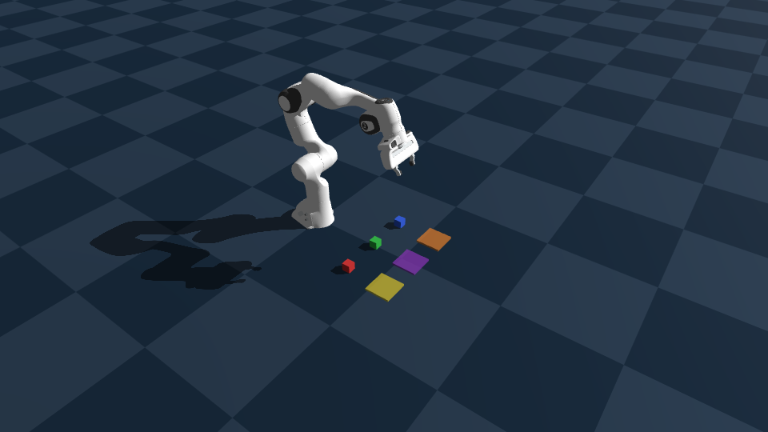
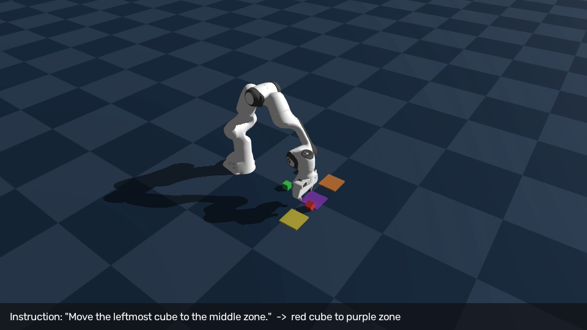
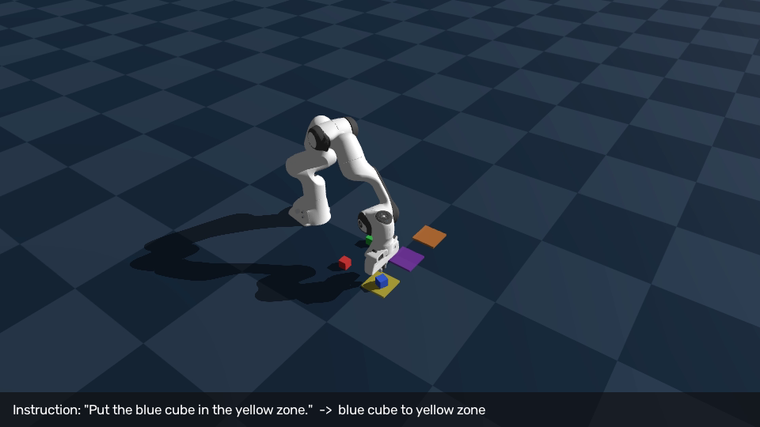

# PAI最終課題 説明資料

## 1. 課題概要

本課題では、ロボットシミュレータ [Genesis](https://genesis-embodied-ai.github.io/) 上に構築した
Franka Panda 7軸アームに対して、**自由形式の自然言語指示**でPick & Placeタスクを実行させる
システムを実装した。核となるのは、**ACT（Action Chunking Transformer）による模倣学習
ポリシー**である。カメラ画像と関節角度（知覚）から、次に取るべき関節角度の列（行動）を
直接予測するニューラルネットワークにより、知覚から行動までを一貫してAIが担う。

このACTを学習させるための実演データは、**IK（逆運動学）とスクリプト制御によるエキスパート
制御器**を自動的に動かして収集した。人間によるテレオペレーションを使わずに、既存の確実な
制御器を「お手本」として走らせることで模倣学習データを量産している。つまりIK制御は、
本課題における主役（ACT）を学習させるための手段であり、同時にそれ自体も確実に動作する
Pick & Placeデモとして独立に提示できる副産物でもある。

自然言語指示は、どちらの実行方式でも共通してAWS Bedrock経由のClaude (Haiku 5.5) で
リアルタイムに解析し、対象ブロックと目標エリアの組を特定する。

## 2. 目的

- 自己収集データからの模倣学習（ACT）によって、**知覚（カメラ画像）から行動（関節角度）
  までを一貫してAIが担う**Pick & Placeポリシーを学習・評価すること。
- そのポリシーの学習データを、IK制御とブロックの摩擦把持による**物理的に妥当な
  エキスパート実演**から自動収集すること（人間のテレオペレーションに依存しない）。
- ハードコードされた固定シーケンスではなく、都度与えられる自然言語の指示に応じて
  行動を変える「指示理解」を、Claudeの推論によって実現すること。

## 3. システム構成

| 要素 | 使用技術 |
|---|---|
| シミュレータ | Genesis 1.4.5（GPUバックエンド, NVIDIA RTX 3090） |
| ロボット | Franka Emika Panda（7軸アーム＋平行グリッパー、Genesis同梱MJCFモデル） |
| AI（自然言語理解） | AWS Bedrock経由 Claude Haiku 5.5（推論のみ、学習なし） |
| AI（物理操作・ACT） | 自作のACT実装（CNN＋Transformer、PyTorch）。学習データは自動収集 |
| 学習データ収集用エキスパート | Genesisのinverse_kinematics APIによるIK、直交空間ウェイポイント補間 |

### タスクの流れ

1. 手前の列に**赤・緑・青**のブロック（4cm角）を3つ、奥の列に**黄・紫・オレンジ**の
   目標エリア（色付きパッド）を3つ、Franka Pandaの作業範囲内に配置する。
2. `commands.json` に記述された自然言語指示を1件ずつClaudeに渡し、
   `{"object_color": "...", "target_color": "..."}` という構造化アクションへ変換する。
   このときシーンの配置情報（手前の列・奥の列の左右順）もプロンプトに含めることで、
   色名を直接含まない空間表現（"the rightmost zone" 等）も解決できるようにしている。
3. ACTポリシーが、天井カメラ・手首カメラの画像と現在の関節角度から、対象ブロックを
   把持し目標エリアまで搬送するための行動チャンクを予測・実行する。
4. ACTの学習データ自体は、IK制御のエキスパートを様々な(ブロック色, エリア色)の
   組み合わせで自動的に走らせて収集した。このエキスパート単体でもPick & Placeを
   実行できる。

## 4. 工夫した点・遭遇した問題と対応

ALOHA/ACT論文（Zhao et al., 2023）に着想を得た簡易実装のAction Chunking Transformerを、
IK制御のエキスパートを自動収集した実演データで学習させた。既存の確実な制御器を
「エキスパート」として扱うことで模倣学習データを量産できる点が、OpenVLA等の汎用VLA
基盤モデルをゼロショットで流用する場合（ロボット形状・カメラ視点の不一致で破綻しやすい）
に比べて現実的だと考えた。

**カメラ構成の設計**: 見下ろし型（天井カメラ）と手首カメラを使用する。手首カメラは**グリッパーの側壁に、
やや根本側(アーム側)から指先方向を見下ろす向き**に設置することで、指とブロックの位置
関係が明確に見える視点を得た。見下ろし型（天井カメラ）に変更し、
84×84という低解像度では画角を絞ってワークスペースを画面いっぱいに映す方が情報量を
活かせることが分かり、両方の位置角度を調整した。

**学習時の正規化**: 関節角度（約±3 rad）と指の開閉幅（0〜0.04 m）のスケール差が
大きいため、素のMSE損失では指の開閉という成否に直結する要素への学習信号がほぼ
無視されてしまう問題があった。行動・関節角度をそれぞれz-score正規化することで
改善した。

**データ量とカメラ構成の比較実験**: 45エピソード／135エピソード、天井カメラのみ／
天井+手首カメラの2×2で比較した。評価は3色×3エリアの**全9通りを網羅的に実行**した。
成功判定は、キューブの最終位置が目標ゾーン中心から6cm以内、かつゾーンパッドに
乗る高さ（2.5cm超）にあることとした。

| エピソード数 | カメラ構成 | 成功数（9通り中） |
|---|---|---|
| 45 | 天井のみ | 2 |
| 45 | 天井+手首 | 0 |
| 135 | 天井のみ | 4 |
| 135 | **天井+手首** | **8** |

データが少ない場合はカメラを増やすとむしろ性能が落ち（2→0）、データを十分に
増やすと手首カメラの情報を活かせるようになる（4→8）という、入力の複雑さと
データ量の間の相互作用が観測された。

**45エピソード・天井のみ（2/9）**: 天井カメラ1台・84×84という低解像度で、
クローズアップの視点がないため、位置推定の精度が全体的に粗いと考えられる。
この精度不足は、程度の差として2つの形で現れている。(1) 配置の僅かなズレ:
キューブを掴んで目標ゾーン付近まで運べているが、中心から7〜9cm程度ズレてしきい値(6cm)をわずかに
外れている。(2) 把持自体の失敗: 一部の試行では、この精度不足がさらに深刻化し、
そもそも把持に至らなかった。

**45エピソード・天井+手首（0/9）**:失敗は一様ではなく、大きく2種類に分かれていることが見て取れる。(1) そもそも
把持に失敗しキューブがほとんど動かない場合と、(2) 把持・搬送自体は行われるが、
指示されたエリアとは異なるパネルの方へ持って行ってしまう場合（例: 黄色エリアへの
指示で紫パネルの方向へ搬送する）がある。ログ上でも、9試行すべてで最終的な
キューブの高さ(`final_z`)が初期の接地高さとほぼ同じ約1.9cmであり、いずれの試行
でもエリアパッド上に置けていないことが確認できる。カメラを1台から2台に増やすと
入力の複雑さが増す一方、45エピソードではそのぶんのデータ量が足りず、把持そのものと、
画像から目標エリアを正しく読み取る（goal-conditioning）ことの両方が崩れたと
考えられる。135エピソードまでデータを増やすと同じ2カメラ構成が最良（8/9）になる
ことから、これはカメラ構成自体の問題ではなく、データ量とのバランスの問題であった
と解釈している。

**135エピソード・天井のみ（4/9）**: 失敗を内訳で見ると、緑のブロックを対象とした
3通り（green→yellow, green→purple, green→orange）が**すべて**把持そのものに
失敗している（キューブがほとんど動かず、持ち上がった形跡もない）。緑のブロックは
手前の列の中央、すなわち天井カメラの直下に置かれているため、アームが把持に近づく
際に自分自身の腕がキューブを隠してしまい（オクルージョン）、天井カメラ1台だけでは
その瞬間のキューブの位置を画像から読み取れなくなっていたと考えられる。手首カメラを
追加した構成（8/9）ではこの3通りすべてが成功しており、この解釈と整合する。つまり
カメラの台数は多いほど良いわけではなく、**実行したいタスクに対してオクルージョンが
発生しない最小限の構成**を選び、その上でその構成を学習しきれるだけのデータ量を
確保する、という両立が必要だと考察した。

**135エピソード・天井+手首（8/9）**: 唯一の失敗はred→purpleで、キューブは把持・
搬送されゾーンパッドの高さ（2.6cm）まで下ろされているが、中心から7.5cmズレて
置かれている。つまり把持の失敗ではなく、配置位置の精度不足である。同じ
red→purpleをIKエキスパート単体（学習データと同じ経路）で実行すると中心から
0.04cmとほぼ正確に置けるため、この精度不足は学習データ自体の配置ズレではなく、
ACTポリシー自身の画像ベースでの位置推定の誤差によるものと考えられる。
エピソード数を増やすことで改善するかは今回の実験の範囲では確認できていない。

## 5. 実用性・今後の展望

ACTについては、135エピソードという小規模データでも傾向が見えたため、エピソード数を
さらに増やす、あるいはCVAE等による本来のACTアーキテクチャに近づけることで、さらなる
精度向上が期待できると考えている。IK制御によるエキスパート実演の収集・ACTへの模倣学習
という構成自体は、実際の倉庫・工場でのピッキング作業において「このラベルの箱をBレーンへ」
といった自然言語指示によるロボット操作に応用できる可能性がある。

## 6. 動画について

提出動画は等速（1倍速）再生であり、倍速処理は行っていない。
